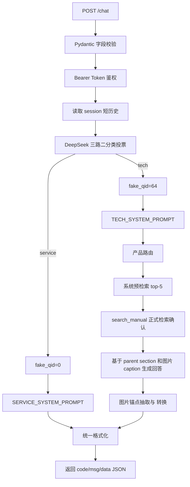

# 智能体 API 接口说明

## 1. 接口定位

本系统以 RESTful API 形式提供多模态客服智能体能力，对外提供 1 个核心对话端点：

```text
POST /chat
```

该端点用于接收用户问题、可选 Base64 图片、会话标识，并返回统一 JSON 格式的智能体回答。系统同时提供健康检查端点：

```text
GET /health
```

`/health` 只用于部署验证，不作为客服交互端点。

## 2. 服务地址

默认启动方式：

```bash
./run_api.sh
```

默认监听：

```text
http://0.0.0.0:8000
```

本机测试地址：

```text
http://127.0.0.1:8000
```

如需调整监听地址或端口：

```bash
HOST=127.0.0.1 PORT=8000 ./run_api.sh
```

## 3. 鉴权方式

`POST /chat` 使用 Bearer Token 鉴权。

服务端不提供默认 token，请在本机 `.env` 或环境变量中设置 `KAFU_API_TOKEN`：

```text
YOUR_SERVICE_TOKEN
```

请求头：

```text
Authorization: Bearer YOUR_SERVICE_TOKEN
Content-Type: application/json
```

如需替换 token，请修改本机 `.env` 中的 `KAFU_API_TOKEN`，或在启动前设置同名环境变量。

## 4. 核心端点：POST /chat

### 4.1 请求方法

```text
POST /chat
```

### 4.2 Content-Type

```text
application/json; charset=utf-8
```

### 4.3 请求体

```json
{
  "question": "椅子的扶手使用一段时间后为什么会松动？",
  "images": [],
  "session_id": "demo-session",
  "stream": false
}
```

### 4.4 请求字段

| 字段 | 类型 | 必选 | 约束 | 说明 |
| --- | --- | --- | --- | --- |
| `question` | string | 是 | 去除首尾空白后长度需大于 0 | 用户问题。可为客服咨询、产品安装、使用说明、故障排查、部件识别等 |
| `images` | array[string] | 否 | 默认最多 3 张；单张默认不超过 5MB | Base64 data URL 图片数组，支持 `png`、`jpg`、`jpeg`、`webp` |
| `session_id` | string | 否 | 建议传入稳定字符串 | 会话标识。用于日志关联和内存态短历史拼接；未传时服务端自动生成 |
| `stream` | boolean | 否 | 当前同步返回 | 协议兼容字段，当前不进行流式分片 |

### 4.5 Base64 图片格式

图片必须使用 data URL 格式：

```text
data:image/png;base64,iVBORw0KGgoAAAANSUhEUg...
```

支持 MIME：

```text
image/png
image/jpeg
image/jpg
image/webp
```

接口层会校验图片数量、data URL 格式和解码后大小。不合法时返回请求校验错误。无图片请求使用 `deepseek-v4-flash`；图片请求使用 `deepseek-v4-flash-vision-exp`，并继续通过Qwen3文本检索把手册正文、图片caption和图文锚点作为证据。

## 5. 请求示例

### 5.1 文本问题

```bash
curl -sS -X POST http://127.0.0.1:8000/chat \
  -H 'Authorization: Bearer YOUR_SERVICE_TOKEN' \
  -H 'Content-Type: application/json' \
  -d '{
    "question": "椅子的扶手使用一段时间后为什么会松动？",
    "session_id": "demo"
  }'
```

### 5.2 带图片字段的问题

```bash
curl -sS -X POST http://127.0.0.1:8000/chat \
  -H 'Authorization: Bearer YOUR_SERVICE_TOKEN' \
  -H 'Content-Type: application/json' \
  -d '{
    "question": "请结合图片判断这个部件应该如何安装？",
    "images": [
      "data:image/png;base64,iVBORw0KGgoAAAANSUhEUg..."
    ],
    "session_id": "demo-image",
    "stream": false
  }'
```

### 5.3 客服类问题

```bash
curl -sS -X POST http://127.0.0.1:8000/chat \
  -H 'Authorization: Bearer YOUR_SERVICE_TOKEN' \
  -H 'Content-Type: application/json' \
  -d '{
    "question": "如果商品到货后有问题，应该如何申请售后？",
    "session_id": "service-demo"
  }'
```

## 6. 成功响应

### 6.1 响应结构

```json
{
  "code": 0,
  "msg": "success",
  "data": {
    "answer": "扶手使用一段时间后松动，通常是因为扶手和椅背的螺丝在使用过程中逐渐松动。\n\n重新拧紧相关螺丝即可解决。",
    "display_answer": "扶手使用一段时间后松动，通常是因为扶手和椅背的螺丝在使用过程中逐渐松动。\n\n重新拧紧相关螺丝即可解决。",
    "images": [],
    "session_id": "demo",
    "timestamp": 1781320057
  }
}
```

### 6.2 响应字段

| 字段 | 类型 | 说明 |
| --- | --- | --- |
| `code` | integer | 业务状态码。`0` 表示成功 |
| `msg` | string | 状态描述。成功时为 `success` |
| `data.answer` | string | 智能体最终回答 |
| `data.display_answer` | string | 浏览器展示文本；保留 `<PIC>`，但不附加尾部图片ID数组 |
| `data.images` | array[object] | 可展示图片列表；客服题及无图技术题为空数组 |
| `data.session_id` | string | 本次响应对应的会话 ID |
| `data.timestamp` | integer | 服务端响应时间戳，Unix 秒级 |

## 7. answer 格式

`data.answer` 与离线批量输出的 `ret` 字段同源，由 `submission_utils.py` 统一格式化。

### 7.1 客服类回答

客服问题返回自然语言文本，不附加手册图片数组。

示例：

```text
您可以先确认商品问题类型，并保留订单信息、商品照片或问题描述，再按平台售后流程提交申请。具体可处理范围以订单页展示的售后入口为准。
```

### 7.2 产品技术类回答

产品技术问题基于手册证据生成。若需要引用手册插图，正文中使用 `<PIC>` 标记，末尾保留图片数组字符串。图片数组顺序与正文 `<PIC>` 出现顺序一致。

示意：

```text
请先确认固定孔位和安装方向，再按说明将支架与主体对齐。<PIC>

["Manual33_10.png"]
```

系统内部使用 `[[PIC:文件名]]` 作为证据锚点，最终转换为 `<PIC>` 与图片数组，减少图片错配、跨手册混图和模型编造图片名。

除保持兼容的 `data.answer` 外，API还把最终图片ID按正文锚点顺序输出到 `data.images`：

```json
{
  "id": "Manual04_22",
  "url": "/manual-images/Manual04_22",
  "mime_type": "image/jpeg",
  "marker_index": 0
}
```

网页可按 `marker_index` 将图片插入对应 `<PIC>` 位置。客服题强制返回空图片数组。

### 7.3 手册图片端点

```http
GET /manual-images/{image_id}
```

服务启动时从 `手册/插图/` 建立只读ID映射；当前2,605个JPG/PNG文件名主干均唯一，Section引用的2,563个图片ID全部可解析。JPG返回 `image/jpeg`，PNG返回 `image/png`，未知ID或路径穿越输入返回404。

### 7.4 内置网页与延迟进度

`GET /`返回同源单文件网页，支持文本提问、最多3张图片上传、会话ID、等待时间以及按 `<PIC>` 顺序显示图片。`GET /latency-baseline/status`只读取后台脚本的本地进度JSON；网页每2秒刷新一次状态，不会因此增加远程模型调用。

## 8. 错误响应

### 8.1 常见 HTTP 状态码

| HTTP 状态码 | 场景 | 说明 |
| ---: | --- | --- |
| 401 | 鉴权失败 | 缺少 `Authorization`、Bearer Token 格式错误或 token 不匹配 |
| 422 | 请求校验失败 | `question` 为空、字段类型错误、图片格式不合法、图片数量或大小超限 |
| 500 | 服务内部错误 | Agent、检索引擎或上游模型出现未预期异常 |
| 503 | 服务端 token 未配置 | `KAFU_API_TOKEN` 为空时拒绝 `/chat` 请求 |
| 504 | 执行超时 | 智能体链路超过文本或多模态请求截止时间；服务端触发协作取消且不写入会话历史 |

### 8.2 错误示例

```json
{
  "detail": "invalid bearer token"
}
```

字段校验错误使用 FastAPI/Pydantic 标准错误结构，便于定位请求格式问题。

## 9. 辅助端点：GET /health

### 9.1 请求

```bash
curl http://127.0.0.1:8000/health
```

### 9.2 响应示例

```json
{
  "status": "ok",
  "engine_ready": true,
  "background_agents": 0,
  "timeout_s": 50.0,
  "multimodal_timeout_s": 60.0,
  "auth_configured": true,
  "classifier_provider": "deepseek_binary_vote",
  "classifier_configured": true,
  "classifier_model": "deepseek-v4-flash"
}
```

### 9.3 字段说明

| 字段 | 说明 |
| --- | --- |
| `status` | API 进程状态。`ok` 表示服务进程正常 |
| `engine_ready` | 检索引擎是否已初始化 |
| `background_agents` | 已返回超时/断开响应、但尚在协作退出过程中的Agent worker数量；正常稳态应为0 |
| `timeout_s` | 文本请求超时时间 |
| `multimodal_timeout_s` | 携带图片请求的超时时间 |
| `auth_configured` | `/chat` 鉴权 token 是否已配置 |
| `classifier_provider` | service / tech 路由器类型 |
| `classifier_configured` | 分类器 endpoint 和 key 是否已配置 |
| `classifier_model` | 分类器模型名称 |

## 10. 在线处理流程



service / tech分类器的历史离线记录和适用范围见 `04_验证报告.md`；API文档不把历史数据作为当前模型效果声明。

当前模型与工具约束：

- 入口分类器：`deepseek-v4-flash`三路并发投票；
- 文本主回答：`deepseek-v4-flash`；
- 图片主回答：`deepseek-v4-flash-vision-exp`；
- Dense/Rerank：`Qwen/Qwen3-Embedding-8B`与`Qwen/Qwen3-Reranker-8B`；
- 技术题在正式检索完成前使用 `tool_choice=required`；客服题不向模型提供工具。

2026-09-02实测四个场景均为HTTP 200：文本技术题、同Session追问、客服题和Base64 PNG图片技术题。三个技术轮次各记录1次 `search_manual`，客服轮次记录0次工具调用。

2026-09-08已完成并发与超时整改：请求级QID不再写入进程环境变量，而由ContextVar隔离；文本/多模态截止时间会下传到LLM、Embedding与Rerank调用。API达到截止时间或客户端任务被取消时会设置协作取消事件，并跟踪尚未退出的worker。Python线程本身不能安全强杀，因此正在进行的socket调用仍需依靠下传的剩余超时返回；返回后状态机会在下一检查点终止，不再继续下一轮检索或生成。

## 11. 一键验证

项目提供 smoke 脚本：

```bash
./smoke_test.sh
```

脚本会依次验证：

1. `GET /health` 是否返回 `status=ok`；
2. `POST /chat` 是否可完成鉴权、路由、检索、生成和统一 JSON 响应。

完整验证口径见 `04_验证报告.md`。
