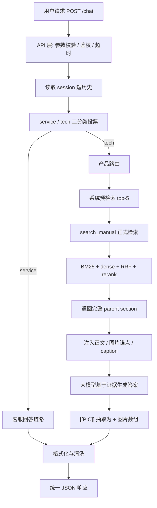

# 技术方案说明

## 1. 方案概述

KBrag V6 面向「具有多模态能力的客服智能体设计」赛题，目标是在统一 `/chat` 接口下处理两类问题：

1. 通用客服问题，如订单、售后、服务流程、购买咨询；
2. 产品技术问题，如安装、使用、维护、故障排查、部件识别、图文说明。

系统以产品手册文本、手册插图和图片 caption 为知识基础，通过客服/技术分轨、产品路由、混合检索、parent section 返回、图文锚点和格式化输出，形成可复核的多模态 RAG 客服智能体。

## 2. 总体架构



该架构将“输入处理、意图路由、产品定位、证据检索、图文绑定、答案生成、输出格式化”拆分为独立模块，便于验证、替换和问题定位。

当前现役Dense FAISS索引仍只覆盖文本与Caption。项目已另行构建2,504×4,096的独立 `visual.faiss`，并加入文本查图、图片查图、Vision描述/OCR回查文本、Section级RRF和VL Rerank；质量与阶段延迟实验已经完成，但相对延迟门槛尚未通过，故 `VISUAL_RETRIEVAL_ENABLED=0`，默认请求仍保持原文本/Caption链路。完整过程见 `08_视觉FAISS四路检索实验与优化复盘.md`。

## 3. 核心痛点与对应解决方案

| 赛题痛点 | 方案设计 |
| --- | --- |
| 客服问题和产品技术问题边界不同 | 在线 `/chat` 先做 service / tech 二分类，分别进入客服 prompt 或技术 RAG 链路 |
| 产品手册多、术语多、跨语言表达多 | 产品路由 + BM25 + dense + RRF + rerank 组合召回 |
| 手册答案常依赖图片、部件和步骤 | 手册解析阶段保留图片锚点，检索结果注入 `[[PIC:文件名]]` 和图片 caption |
| 小 chunk 容易漏上下文，大 section 又容易干扰 | chunk 作为召回单元，命中后返回完整 parent section |
| 大模型容易泛化补充或编造图片 | 技术 prompt 要求基于检索证据，formatter 只接受证据中的图片锚点 |
| 项目需要可复现、可验证 | 提供启动脚本、smoke 脚本、静态自检脚本、参考 CSV 和验证文档 |

## 4. 客服 / 技术分轨

在线 `/chat` 没有离线题号，因此路由判断在 `api_server.py` 中完成。系统先使用 DeepSeek V4 Flash 三路二分类投票判断问题来源，再把结果映射为 `fake_qid` 复用 `agent.py` 的离线硬路由逻辑：

```text
route=service → fake_qid=0  → SERVICE_SYSTEM_PROMPT
route=tech    → fake_qid=64 → TECH_SYSTEM_PROMPT + 产品路由 + 手册 RAG
```

三路 prompt 的代码名称为 `service_guard`、`tech_recall`、`answer_source`。三路并发调用后，系统只接受纯 `0/1` 输出：`0=service`，`1=tech`，再按投票结果决定路由。历史离线记录及其适用范围集中保留在 `04_验证报告.md`，这里不重复性能数字。

这种分轨的代码边界是：service 分支通过 `fake_qid=0` 选择 `SERVICE_SYSTEM_PROMPT`，并跳过产品路由和系统预检索，代码级不传工具；tech 分支通过 `fake_qid=64` 进入产品路由、预检索和 `search_manual`，在正式检索确认前使用 `tool_choice=required`。无图片请求使用 `deepseek-v4-flash`，上传图片时切换 `deepseek-v4-flash-vision-exp`。

## 5. 产品路由

技术问题进入 RAG 前，需要判断涉及的产品或手册。系统采用两级路由：

1. 显式匹配：产品名、型号、别名、手册名；
2. 内容投票：问题未明确产品时，根据候选手册内容进行软匹配。

产品路由只用于缩小检索范围，不作为最终答案来源。对于模糊问题，系统保留候选空间，允许后续 `search_manual` 检索自纠。

## 6. 多模态 RAG 检索

### 6.1 检索链路

```text
query
  ↓
BM25 sparse retrieval
  +
dense vector retrieval
  ↓
RRF 融合
  ↓
rerank 精排
  ↓
chunk 命中
  ↓
完整 parent section 返回
```

### 6.2 BM25

BM25 负责精确术语召回，适合产品名、部件名、按钮名、错误码、型号、英文缩写和手册原文关键词。

### 6.3 Dense 向量检索

Dense 检索负责语义召回，当前使用硅基流动 `Qwen/Qwen3-Embedding-8B`。现役索引包含6,570条4096维L2归一化向量，使用 `faiss.IndexFlatIP` 做精确内积检索；原1024维BGE-M3索引单独归档，不与Qwen3查询向量混用。

系统预检索发送1条原始问题。正式 `search_manual` 会选出主Dense Query和动态数量的去重关键词Query；现役 `TEXT_QUERY_EMBED_MODE=batch` 将这些已经选定的文本合并为一次 `/embeddings` 请求，再把返回向量分别用于原有FAISS排名，`serial` 环境变量可回退。该开关只改变HTTP发送方式，不增加关键词、不修改Tool Call，也不把BM25、RRF或Rerank改成并发。

39份手册共用同一个文本FAISS索引。产品路由只生成允许使用的Chunk ID集合：全库检索直接调用 `IndexFlatIP.search()`，限定产品时在对应向量子集上执行NumPy内积，不会并行查询39个独立知识库。Parent Section已加载到内存字典，最终结果仅按 `(product, parent_section_id)`逐条回查，不涉及数据库、磁盘或远程批量查询。

### 6.4 RRF 融合与 rerank

RRF 用于融合 BM25 与 dense 的候选排序，降低单一路径失效风险。当前使用 `Qwen/Qwen3-Reranker-8B` 对融合候选进行二次排序，`RERANK_CANDIDATE_POOL`现役配置上限为20。2026-09-08完成的B34/C20/C10三组对照以历史参数80为Baseline：固定 `keywords=[]`时实测候选最大34；C20保持30/30 Recall@5和0.9611 MRR，并降低Rerank中位数与P95，C10的MRR降至0.9444。完整检索P95受远程Embedding长尾影响，未证明改善。

文本与VL Embedding/Rerank客户端按工作线程复用 `requests.Session`，减少同一线程连续远程调用的连接建立成本，同时避免跨并发线程共享一个Session。

### 6.5 Chunk 检索与 Parent Section 返回

系统使用 chunk 做召回和排序，但最终返回完整 parent section。原因是产品手册中的有效答案经常跨越步骤、注意事项、图片说明和例外条件。只返回小 chunk 容易漏关键上下文；直接返回过大章节又会引入干扰。parent section 是当前版本在精确性与完整性之间的折中。

现役切分参数为Target 160、Overlap 24、短尾阈值70、长句细切阈值240，长度单位是删除空白与 `<PIC>` 后的近似字符数，四项均为软目标而非硬边界。2026-09-09已使用冻结30题完成P120/P160/P200三组、每组3轮对照：三组每轮Section Recall@5均为30/30；P200在问题123、153、241上三轮稳定从第1降到第2，P120与P160前两轮逐题排名完全一致，名义差异只来自P160问题241的一次Rerank波动。P120还增加32.8% Chunk与FAISS，因此继续保留现役P160，不修改生产索引。完整切分方法与实验记录见 `06_分词与检索优化实验设计.md`。

### 6.6 文档结构与混合分词边界

Section解析依赖行首1—3级Markdown标题。标题被改为普通段落、缺少 `#` 后空格或层级混乱时，正文会继续并入上一个Section，造成Section减少、主题混杂和Parent Section过大；Chunk仍可按句子切分，但标题语义、图片归属和回溯上下文质量会下降。

当前BM25分词使用jieba搜索模式并自行补中文双字片段，因此两字词可能重复。只要正文包含 `<PIC>`、`USB`等ASCII字母，英文补充分词还会扫描整段混合文本，产生 `pic`或整句中文Token。该现象已通过人体工学椅样例复现，但是否降低检索质量仍属待实验结论，必须用固定查询集比较Recall@K/MRR后再决定是否修改。

实验用 `tokenize_mixed_clean()` 已实现结构标记清理、基于字符位置的意外重复消除和ASCII片段提取，但未接入现役BM25。它保留不同文本位置的真实重复词，避免用全局去重破坏BM25词频。

### 6.7 Section Summary元数据

`data/section_summaries.json` 在索引加载后挂到 `section["llm_summary"]`，用于章节元数据和后续目录摘要能力。当前BM25/Dense索引文本仍读取Chunk自带的 `summary`，Agent结果中的 `section_summary`也仍来自Section原 `summary`；因此单独清理 `section_summaries.json` 不会改变现役检索排名，也不需要重建FAISS/BM25。

2026-09-08已删除54个不再对应当前Section的尾部键，并针对8个发生Section拆分/编号位移的产品重建373条摘要。最终1,943个Section全部具有一一对应、非空且无错误标记的Summary；清理审计见 `validation_outputs/section_summary_cleanup.json`。

### 6.8 独立视觉检索（代码就绪，默认关闭）

视觉链路使用 `Qwen/Qwen3-VL-Embedding-8B` 将手册插图写入独立 `data/visual_index/visual.faiss`，不与文本 `dense.faiss` 混合。技术图片请求会并行执行Vision事实描述/OCR和图片向量召回；纯文本仅在按钮、部件、接口、位置、图示等视觉意图下执行文本查图。文本Chunk和视觉图片先统一映射到 `产品|Parent Section ID`，再做跨通道RRF和 `Qwen/Qwen3-VL-Reranker-8B` 图文精排。

2026-09-15已完成公开接口探测和2,504×4,096独立视觉索引。2026-09-16先完成480条四组检索与180条文本回归，随后修正融合结构：原始问题与Vision扩展问题各自保留独立文本排名，再与文本找图、图片找图做Section级RRF。配对240条实验中，新融合相对无视觉FAISS的Vision文本基线将Section Recall@5从60.83%升至78.33%，Image Recall@5从55.00%升至67.50%。

2026-09-17进一步增加阶段级计时，并完成B/P/M/S及顺序平衡确认。三次相同四路P结构的P95分别为16.47、71.57和12.26秒；极端长尾主要落在远程文本Embedding，VL Embedding另出现两次约120秒后HTTP 500，本地FAISS/RRF和VL Rerank不是极端长尾来源。合并文本候选M和文本单并发S均未证明稳定优于P，因此保留四路质量结构，当前仍不默认启用。

## 7. 图文绑定与多模态信息解析

### 7.1 图片锚点

手册解析阶段将图片与章节文本绑定，在检索证据中保留：

```text
[[PIC:图片文件名]]
```

模型回答时只保留与问题直接相关的图片锚点。最终由 `submission_utils.py` 将内部锚点转换为平台格式：

```text
正文 <PIC>

["图片文件名.png"]
```

图片数组顺序严格按正文 `<PIC>` 出现顺序生成。

### 7.2 图片 caption

`data/image_captions_v4_final.json` 维护图片语义描述，用于说明图片中的：

- 部件；
- 按钮；
- 接口；
- 方向箭头；
- 状态灯；
- 安装位置；
- 表格或示意图含义。

caption 作为辅助证据进入检索和生成上下文，帮助模型判断图片是否与问题相关。caption 不替代手册正文，也不要求模型逐字照抄。

### 7.3 用户上传图片

`/chat` 支持 Base64 data URL 图片字段。接口层会完成格式、数量和大小校验，并将图片作为本轮多模态消息传入 `deepseek-v4-flash-vision-exp`；文字仍用于分类、产品路由和Qwen3文本检索。2026-09-02已用真实PNG完成一次端到端验证，模型正确识别空气炸锅取篮动作，并在正式 `search_manual` 检索后返回手册图片锚点。

## 8. ReAct 工具流程

技术链路仅暴露一个主动检索工具：

```text
search_manual
```

工具说明写在：

```text
skills/search_manual.md
```

当前策略：

- 技术题正式回答前至少调用一次 `search_manual`；
- 正式检索尚未确认时，OpenAI-compatible调用使用 `tool_choice=required`，不再只依赖Prompt要求模型主动检索；
- 系统预检索只作为首轮定位线索，不能替代正式工具检索；
- `search_manual` 最多允许两次，第二次仅用于证据明显错路由或完全不覆盖问题时的补救；
- 若第一次检索已命中最相关 parent section，应直接基于证据收束；
- 不重新启用旧版 `manual_reader/use_skill/list/read` 工具链，减少无效轮次和超时风险。

2026-09-02的四项API回归中，两个文本技术轮次和一个图片技术轮次均记录1次正式工具调用；客服轮次记录0次工具调用。

## 9. 幻觉抑制机制

客服分支没有接入具体平台政策或订单状态，因此V2 Prompt明确禁止推断处理时效、赔付金额、费用承担、责任归属和平台执行机制；允许回答低风险通用步骤，并在用户追问时根据短历史按需补充。当前已完成原6题单轮复测及两条代表场景的三轮对照；原6题单次采样事实边界为4/6，S02与S04暴露了失败模式，但不能把一次采样当成稳定失败率。下一步先对固定Prompt重复采样并增加同义改写保留题，再决定是否修改Prompt。完整证据与适用边界见 `07_客服Prompt事实边界优化记录.md`。

| 风险 | 抑制方式 |
| --- | --- |
| 技术题凭常识回答 | 技术 prompt 要求基于手册证据；回答前必须 `search_manual` 显式确认 |
| 错产品或错章节 | 产品路由、预检索、正式检索和 rerank 多层校正 |
| 回答过度发散 | V6 prompt 收窄为同一最相关章节内的直接补充 |
| 编造图片名 | 只允许使用检索证据中的 `[[PIC:文件名]]`；formatter 统一抽取 |
| 图片无关或顺序错 | 图片随正文锚点排序，不用无关图片凑数 |
| 客服题混入技术格式 | service / tech 分轨，客服题走独立 prompt 和客服清洗 |
| 平台格式不兼容 | 最终输出由 `submission_utils.py` 统一处理 |

## 10. 对话记忆管理

接口支持 `session_id`。API 层为同一 `session_id` 保留内存态短历史，并在下一轮请求前拼接为上下文前缀，让系统能处理轻量连续追问。

当前边界：

- 历史只保存在当前进程内存中；
- 默认保留最近若干条消息；
- 服务重启后历史清空；
- 未接入 Redis、数据库或长期用户画像。

该设计满足多轮入口和连续追问的验证需要，同时避免复杂持久化状态增加本地复现成本。

### 10.1 请求上下文与协作超时

请求级QID、截止时间和取消事件由 `request_context.py` 的ContextVar保存，避免并发线程通过进程环境变量共享题号。API为Agent worker创建独立请求作用域；作用域退出时自动恢复上一个上下文。

文本和多模态请求分别使用统一截止时间。分类、主LLM、Embedding、Rerank、LLM并发信号量等待和Rerank重试退避都会读取剩余请求预算。达到截止时间或调用协程取消时，API设置线程安全的取消事件；Agent在每轮决策及远程调用前检查，并在当前阻塞调用返回后停止后续步骤。`/health` 的 `background_agents`显示已经返回超时/断开响应、但尚处于协作退出过程的worker数量。

Python没有安全终止任意线程的机制，所以这里不宣称“504瞬间杀死线程”。真实保证是：远程socket超时不会超过请求剩余预算、重试不会越过截止时间、调用返回后不再继续下一轮，且后台worker会被跟踪并消费结果。若未来要求严格进程级强制终止，需要把Agent迁移到独立进程worker。

## 11. 自主学习与迭代闭环

当前版本不在请求过程中自动写回知识库，也不在线修改 prompt 或手册，以避免未审核内容污染手册证据。

系统的“自主演进”体现在离线闭环：


这一路径可以持续提升系统质量，同时保持正式运行时知识库可控、可审计。

## 12. 可观测性

系统支持以下观测信息：

- API 请求 ID、session ID、耗时、图片数量；
- service / tech 分类结果和三路投票输出；
- 产品路由结果；
- 系统预检索命中；
- `search_manual` 工具调用；
- 检索命中的 parent section；
- 图片锚点和最终图片数组；
- 原始回答与格式化回答。

离线跑批可生成 `csv + raw.jsonl + trace.jsonl`，用于回看检索、生成和图片引用链路。项目目录默认不保留大量临时 trace，避免干扰源码和固定验证产物。

系统预检索和正式 `search_manual` 均已接入分阶段Trace。正式Tool事件记录主BM25、主/关键词Dense、RRF、关键词与原问题Rerank、Parent Section回填、输入条数、HTTP状态和总耗时；视觉开启时还区分原始文本与扩展文本子链路。Trace用于定位阶段耗时，不保存API Key、向量或完整远程响应。当前仍不能把远程长尾直接归因为限流，因为现有记录没有429证据。

## 13. 技术亮点

1. **统一 API 下的双轨智能体**：一个 `/chat` 同时处理客服与产品技术问题，入口统一、内部路径分离。
2. **多阶段产品定位**：显式匹配和内容投票结合，降低相似产品误路由风险。
3. **Hybrid RAG 与 parent section 返回**：chunk 负责精确召回，parent section 保证回答上下文完整。
4. **图文锚点闭环**：图片从手册解析、检索证据、模型回答到最终 `<PIC>` 输出保持同一链路。
5. **Caption 辅助理解**：图片语义描述进入检索和证据判断，增强多模态问答稳定性。
6. **检索工具纪律**：保留 `search_manual` 一个主工具，明确何时检索、何时停止，降低超时和无效搜索。
7. **可复现工程**：内置索引、手册、插图、默认配置、启动脚本和验证脚本，便于本地复现。
8. **阶段级可观测与取舍**：将远程Embedding/Rerank、VL调用和本地融合分段计时，用固定金标验证替代方案，在没有稳定收益时停止继续增加复杂度。

## 14. 当前版本总结

KBrag V6 以手册证据驱动产品技术问答，以客服/技术分轨保证不同问题的回答边界，以图文锚点和 caption 解决多模态证据对齐问题。系统已经封装为可启动、可调用、可验证的 RESTful API，并保留后续检索对照实验所需的离线数据与 trace 能力。视觉FAISS四路PoC已完成质量、延迟定位和替代方案消融，后续项目重心转向深入理解现有架构与调用链。
